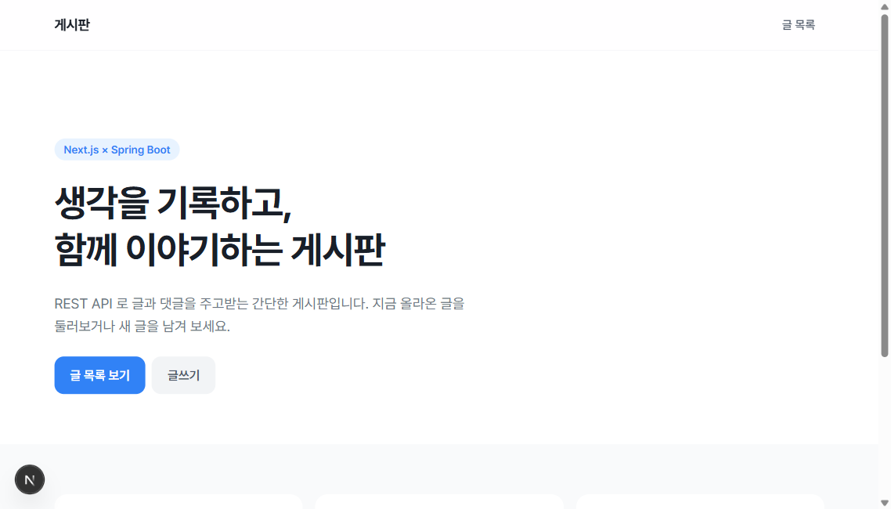
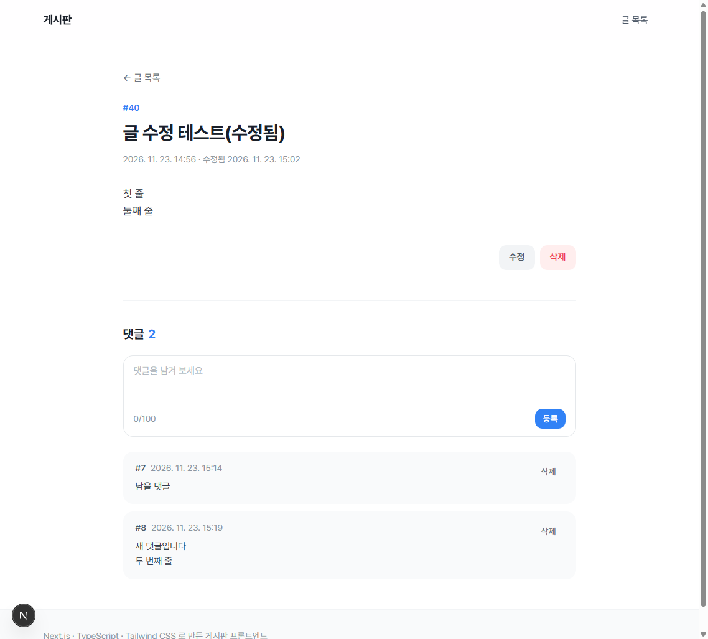
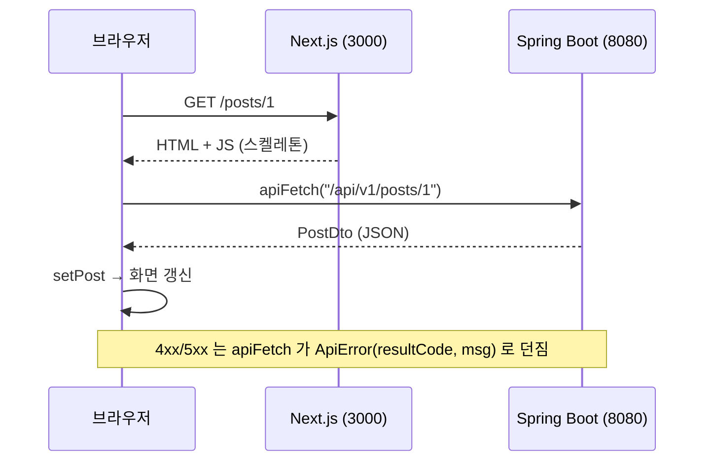

# p-14175-2 — Next.js 게시판 프론트엔드

스프링부트 REST API(글/댓글)를 호출하는 Next.js 프론트엔드를 처음부터 만들어 가는 학습용 저장소입니다. 홈 → 글 CRUD → 댓글 순서로 기능 단위 커밋을 쌓았습니다.

- 모든 커밋에는 `001`, `002` … 처럼 **순번 태그**가 붙어 있습니다.
- 커밋 메세지는 **Conventional Commits** 형식(`feat:`, `style:`, `chore:`, `docs:`)이며, 본문에 **무엇을 / 왜 / 확인** 이 자세히 적혀 있습니다.
- 단계별 상세 기록은 파트별 문서([1부](docs/part1-setup.md) · [2부](docs/part2-posts.md) · [3부](docs/part3-comments.md))에 있습니다.

    

## 목차
- [학습 흐름](#학습-흐름)
- [기술 스택과 실행 방법](#기술-스택과-실행-방법)
- [커밋 따라가는 방법](#커밋-따라가는-방법)
- [화면과 라우트](#화면과-라우트)
- [전체 구조 한눈에 보기](#전체-구조-한눈에-보기)
- [사용하는 백엔드 API](#사용하는-백엔드-api)
- [강의 코드와 다르게 구현한 부분](#강의-코드와-다르게-구현한-부분)
- [핵심 개념 정리](#핵심-개념-정리)
- [검증 결과](#검증-결과)

## 학습 흐름

| 파트 | 태그 | 무엇을 만드나 | 핵심 개념 | 상세 |
|---|---|---|---|---|
| 1부 | 001 ~ 005 | 프로젝트 생성, 디자인 토큰·레이아웃, **홈**, API 클라이언트 | App Router, Cache Components, 서버/클라이언트 컴포넌트, `fetch` 와 `res.ok` | [1부 문서](docs/part1-setup.md) |
| 2부 | 006 ~ 010 | **글 다건조회 → 단건조회 → 삭제 → 작성 → 수정** | `useEffect` fetch, 초기값 `null`, `useParams` + `loading.tsx`, 커스텀 훅, `router.replace`, 유효성 검사 | [2부 문서](docs/part2-posts.md) |
| 3부 | 011 ~ 013 | **댓글 다건조회 → 삭제 → 작성** | 훅 분리, `ReturnType`, 함수형 업데이트로 즉시 반영 | [3부 문서](docs/part3-comments.md) |
| 정리 | 014 | README, 파트별 문서 | - | - |

## 기술 스택과 실행 방법

| 구분 | 내용 |
|---|---|
| 프레임워크 | Next.js 16.4.6 (App Router, Cache Components, React Compiler) |
| 언어 | TypeScript 5.9 |
| UI | React 19.3, Tailwind CSS 4.3 (`@tailwindcss/turbopack`), Pretendard |
| 패키지 매니저 | pnpm 12.21.0 |
| 품질 | ESLint (`eslint-config-next`), `tsc --noEmit` |
| 백엔드 | [jhs512/p-14172-2](https://github.com/jhs512/p-14172-2/tree/068) `068` 태그 (Spring Boot, Java 25) |

**1. 백엔드 실행** (포트 8080, CORS 로 `http://localhost:3000` 허용)
```bash
git clone --branch 068 https://github.com/jhs512/p-14172-2.git
cd p-14172-2
./gradlew bootRun        # 윈도우 파워셸: .\gradlew.bat bootRun
```

**2. 프론트엔드 실행** (포트 3000)
```bash
git clone https://github.com/tbafe26/p-14175-2.git
cd p-14175-2
pnpm install
pnpm dev                 # http://localhost:3000
```

| 명령 | 설명 |
|---|---|
| `pnpm dev` | 개발 서버 |
| `pnpm build` / `pnpm start` | 프로덕션 빌드 / 실행 |
| `pnpm typecheck` | 라우트 타입 생성 후 타입 검사 |
| `pnpm lint` | ESLint |

- 백엔드 주소 기본값은 `http://localhost:8080` 입니다. 바꾸려면 로컬 전용 환경변수 파일에 `NEXT_PUBLIC_API_BASE_URL=주소` 를 적습니다(`NEXT_PUBLIC_` 이 붙은 값만 브라우저 코드에 포함됩니다).

## 커밋 따라가는 방법

- **변경 내용(diff)** : `https://github.com/tbafe26/p-14175-2/commit/태그`
- **그 시점의 코드** : `https://github.com/tbafe26/p-14175-2/tree/태그`
- **내 PC에서** :
  ```bash
  git checkout 007      # 007 단계 코드로 이동
  git checkout main     # 최신으로 복귀
  ```

| 태그 | 커밋 |
|---|---|
| [`001`](https://github.com/tbafe26/p-14175-2/commit/001) | `chore: Next.js 프로젝트 생성` |
| [`002`](https://github.com/tbafe26/p-14175-2/commit/002) | `chore: 에디터 설정, 줄바꿈, Node 버전 고정` |
| [`003`](https://github.com/tbafe26/p-14175-2/commit/003) | `style: 디자인 토큰과 공통 레이아웃(헤더, 푸터) 적용` |
| [`004`](https://github.com/tbafe26/p-14175-2/commit/004) | `feat: 홈 페이지 구현` |
| [`005`](https://github.com/tbafe26/p-14175-2/commit/005) | `feat: 백엔드 API 클라이언트와 글/댓글 타입 정의` |
| [`006`](https://github.com/tbafe26/p-14175-2/commit/006) | `feat: 글 다건조회(글 목록) 페이지 구현` |
| [`007`](https://github.com/tbafe26/p-14175-2/commit/007) | `feat: 글 단건조회(글 상세) 페이지 구현` |
| [`008`](https://github.com/tbafe26/p-14175-2/commit/008) | `feat: 글 삭제 기능 구현` |
| [`009`](https://github.com/tbafe26/p-14175-2/commit/009) | `feat: 글 작성 기능 구현` |
| [`010`](https://github.com/tbafe26/p-14175-2/commit/010) | `feat: 글 수정 기능 구현` |
| [`011`](https://github.com/tbafe26/p-14175-2/commit/011) | `feat: 댓글 다건조회(댓글 목록) 구현` |
| [`012`](https://github.com/tbafe26/p-14175-2/commit/012) | `feat: 댓글 삭제 기능 구현` |
| [`013`](https://github.com/tbafe26/p-14175-2/commit/013) | `feat: 댓글 작성 기능 구현` |
| [`014`](https://github.com/tbafe26/p-14175-2/commit/014) | `docs: README 와 파트별 학습 문서 작성` |

## 화면과 라우트

| 경로 | 화면 | 기능 | 렌더링 |
|---|---|---|---|
| `/` | 홈 | 소개, 글 목록/글쓰기 이동 | 서버 컴포넌트(정적) |
| `/posts` | 글 목록 | 글 다건조회 | 클라이언트 |
| `/posts/write` | 글쓰기 | 글 작성 | 클라이언트 |
| `/posts/[id]` | 글 상세 | 글 단건조회, 글 삭제, 댓글 다건조회·작성·삭제 | 클라이언트 (Partial Prerender) |
| `/posts/[id]/edit` | 글 수정 | 글 수정 | 클라이언트 (Partial Prerender) |

| 홈 | 글 상세 + 댓글 |
|---|---|
|  |  |

## 전체 구조 한눈에 보기

### 데이터 흐름 (클라이언트 컴포넌트)



### 폴더 구조

```
src
├─ app
│  ├─ layout.tsx               공통 헤더/푸터
│  ├─ globals.css              디자인 토큰(@theme), 글꼴
│  ├─ page.tsx                 홈
│  └─ posts
│     ├─ page.tsx              글 목록
│     ├─ write/page.tsx        글쓰기
│     └─ [id]
│        ├─ loading.tsx        Suspense 경계 (useParams 용)
│        ├─ page.tsx           글 상세 (훅 실행, 하위에 결과 전달)
│        ├─ edit/page.tsx      글 수정
│        └─ _components        PostInfo, PostCommentSection, PostCommentWrite, PostCommentList
├─ components
│  ├─ post/PostForm.tsx        글 작성/수정 공용 폼
│  └─ ui                       buttonClass, ErrorState
├─ hooks                       usePost, usePostComments
├─ lib
│  ├─ backend/client.ts        apiFetch, ApiError, RsData
│  ├─ format.ts                날짜 포맷
│  └─ validation.ts            입력 검사 규칙
└─ types/post.ts               PostDto, PostCommentDto, 요청 본문 타입
```

## 사용하는 백엔드 API

| 기능 | 메서드 | 경로 | 요청 본문 | 응답 |
|---|---|---|---|---|
| 글 다건조회 | GET | `/api/v1/posts` | - | `PostDto[]` |
| 글 단건조회 | GET | `/api/v1/posts/{id}` | - | `PostDto` |
| 글 작성 | POST | `/api/v1/posts` | `{ title, content }` | `RsData<PostDto>` (`201-1`) |
| 글 수정 | PUT | `/api/v1/posts/{id}` | `{ title, content }` | `RsData` (`200-1`) |
| 글 삭제 | DELETE | `/api/v1/posts/{id}` | - | `RsData` (`200-1`) |
| 댓글 다건조회 | GET | `/api/v1/posts/{postId}/comments` | - | `PostCommentDto[]` |
| 댓글 작성 | POST | `/api/v1/posts/{postId}/comments` | `{ content }` | `RsData<PostCommentDto>` (`201-1`) |
| 댓글 삭제 | DELETE | `/api/v1/posts/{postId}/comments/{id}` | - | `RsData` (`200-1`) |

- 실패 응답도 `RsData` 형태입니다. 예: 없는 글 → 404 `{"resultCode":"404-1","msg":"해당 데이터가 존재하지 않습니다."}`
- 입력 규칙(백엔드와 동일): 제목 2~100자, 내용 2~5000자, 댓글 2~100자

## 강의 코드와 다르게 구현한 부분

[강의](https://www.slog.gg/p/14175)와 [강의 코드](https://github.com/jhs512/p-14175-3)를 따라가되, 아래는 더 나은 방법이라 판단해 바꾼 부분입니다.

| 주제 | 강의 코드 | 이 저장소 | 이유 |
|---|---|---|---|
| 오류 처리 | 응답 본문 객체를 그대로 throw | `ApiError` 클래스 + 네트워크 오류 구분 | `catch` 에서 타입이 분명하고, 서버가 꺼진 경우도 메시지를 보여 줌 |
| 응답 타입 | `apiFetch` 가 `any` 반환 | `apiFetch<T>()` 제네릭 | 호출하는 쪽에서 응답 필드 자동완성·타입 검사 |
| 검사 안내 | `alert` 로 하나씩 | 칸 아래 오류 문구 + 첫 칸 포커스 | 여러 칸을 한 번에 고칠 수 있음 |
| 작성/수정 폼 | 페이지마다 따로 작성 | `PostForm` 공용 컴포넌트 | 검사 규칙이 한 곳에 모임 |
| 목록 상태 갱신 | `setPostComments(postComments.filter(...))` | `setPostComments(prev => ...)` | 요청 중 생긴 변경을 덮어쓰지 않음 |
| 로딩 표시 | `로딩중...` 문구 | 스켈레톤 | 레이아웃이 덜 흔들림 |
| 중복 요청 | 제한 없음 | 요청 중 버튼 비활성화 | 두 번 클릭으로 같은 요청이 나가는 것 방지 |
| API 주소 | 환경변수 파일을 저장소에 커밋 | 코드 기본값 + 로컬 환경변수로 덮어쓰기 | 클론 직후 바로 실행, 환경변수 파일은 저장소에 두지 않음 |

## 핵심 개념 정리

<details>
<summary><b>서버 컴포넌트와 클라이언트 컴포넌트</b> — 1부</summary>

- App Router 의 컴포넌트는 기본이 서버 컴포넌트입니다. 상태(`useState`), 효과(`useEffect`), 이벤트(`onClick`)가 필요하면 파일 맨 위에 `"use client";` 를 붙입니다.
- 홈은 상호작용이 없어 서버 컴포넌트로 두고, 브라우저에서 API 를 부르는 목록·상세·폼은 클라이언트 컴포넌트입니다.
</details>

<details>
<summary><b>fetch 는 비동기이고, 4xx/5xx 에서 실패하지 않는다</b> — 1부·2부</summary>

- `fetch()` 는 Promise 를 돌려줍니다. 응답을 기다리는 동안에도 화면은 그려지고 사용자는 조작할 수 있으므로 로딩 상태를 보여 줍니다.
- Promise 체인 중간에서 예외가 나면 남은 `then` 은 건너뛰고 `catch` 로 갑니다. 하지만 `fetch` 는 HTTP 오류 상태에서도 정상 이행되므로 `res.ok` 를 직접 확인해 예외를 던져야 합니다.
</details>

<details>
<summary><b>목록 상태의 초기값은 null</b> — 2부·3부</summary>

- `[]` 로 시작하면 "불러오는 중"과 "데이터 없음"을 구분할 수 없습니다. `null`(로딩) / `[]`(없음) / `[...]`(있음) 세 상태를 각각 그립니다.
</details>

<details>
<summary><b>useParams 와 loading.tsx (Cache Components)</b> — 2부</summary>

- Cache Components 가 켜져 있으면 요청 시점에만 알 수 있는 값(`useParams()`)을 읽는 부분이 `<Suspense>` 안에 있어야 나머지를 미리 렌더링할 수 있습니다.
- 같은 폴더의 `loading.tsx` 가 그 폴더의 페이지를 자동으로 Suspense 로 감쌉니다. `[id]/loading.tsx` 하나로 상세와 수정 페이지를 모두 덮습니다.
- path 파라미터는 항상 문자열이므로 `Number()` 로 바꿔 씁니다.
</details>

<details>
<summary><b>커스텀 훅, 클로저, ReturnType</b> — 2부·3부</summary>

- `usePost(id)`, `usePostComments(postId)` 는 데이터와 그 데이터를 바꾸는 함수를 함께 돌려줍니다. 화면 컴포넌트는 그리기에만 집중합니다.
- 훅 안의 함수는 훅이 받은 id 를 기억(클로저)하므로 다시 넘길 필요가 없습니다.
- 하위 컴포넌트는 `ReturnType<typeof usePostComments>` 로 props 타입을 정해, 훅이 바뀌어도 타입을 따로 고치지 않습니다.
</details>

<details>
<summary><b>요청 성공 후 상태 갱신과 함수형 업데이트</b> — 3부</summary>

- 서버에서 바뀐 내용을 화면에 반영하려면 상태도 함께 바꿔야 합니다(삭제는 filter, 작성은 응답 data 를 추가).
- `setState(prev => ...)` 는 반영 시점의 최신 값을 기준으로 하므로, 비동기 응답을 기다리는 사이 상태가 바뀌어도 안전합니다.
</details>

<details>
<summary><b>router.push 와 router.replace</b> — 2부</summary>

- 작성·수정·삭제 후에는 `replace` 로 이동해 방문 기록에 폼이나 삭제된 글 화면을 남기지 않습니다. 뒤로 가기로 같은 글을 또 올리거나 없는 글에 도착하지 않습니다.
</details>

## 검증 결과

- 모든 커밋 시점에 `tsc --noEmit`, `eslint src` 통과
- `pnpm build` 성공 (013 시점): `/`, `/posts`, `/posts/write` 정적, `/posts/[id]`, `/posts/[id]/edit` Partial Prerender
- 기능마다 실제 백엔드(`068`)를 띄운 상태에서 브라우저로 흐름을 확인하고, 결과를 커밋 메세지와 파트별 문서의 "확인" 에 기록했습니다.
