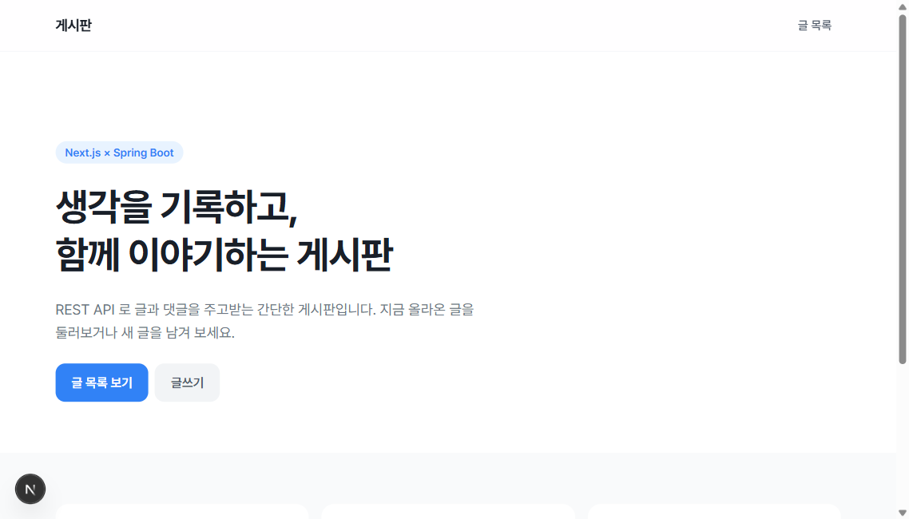

# 1부. 프로젝트 세팅, 디자인, 홈 (001 ~ 005)

[← README](../README.md) · **1부** · [2부](part2-posts.md) · [3부](part3-comments.md) · [4부](part4-refactor-comment-modify.md)

## 요약

| 태그 | 커밋 | 내용 | 핵심 개념 |
|---|---|---|---|
| [`001`](https://github.com/tbafe26/p-14175-2/commit/001) | `chore` | Next.js 프로젝트 생성 | create-next-app, App Router, Cache Components |
| [`002`](https://github.com/tbafe26/p-14175-2/commit/002) | `chore` | 에디터 설정, 줄바꿈, Node 버전 고정 | `.vscode/settings.json`, `.gitattributes` |
| [`003`](https://github.com/tbafe26/p-14175-2/commit/003) | `style` | 디자인 토큰과 공통 레이아웃 | Tailwind v4 `@theme`, 레이아웃 vs 페이지 역할 |
| [`004`](https://github.com/tbafe26/p-14175-2/commit/004) | `feat` | 홈 페이지 | 서버 컴포넌트, `Link` |
| [`005`](https://github.com/tbafe26/p-14175-2/commit/005) | `feat` | API 클라이언트와 타입 | `apiFetch`, `res.ok`, `Headers`, `NEXT_PUBLIC_` |

## 단계별 상세

#### 001 Next.js 프로젝트 생성
[이 시점의 코드](https://github.com/tbafe26/p-14175-2/tree/001) · [변경 내용](https://github.com/tbafe26/p-14175-2/commit/001)

**무엇을** 아래 명령으로 만든 프로젝트를 올렸습니다. README 는 학습 기록용 뼈대로 바꾸고, `package.json` 에 `typecheck` 스크립트를 추가했습니다.

```bash
pnpm create next-app@16.4.6 p-14175-2 --ts --tailwind --eslint --app --src-dir \
  --import-alias "@/*" --use-pnpm --react-compiler --cache-components \
  --no-agents-md --no-agent-feedback
```

**왜** 이후 모든 단계가 이 뼈대 위에 쌓입니다. `--cache-components` 는 Next.js 16 의 Cache Components 를 켜서 `next.config.ts` 에 `cacheComponents: true`, `partialPrefetching: true` 가 들어갑니다. Tailwind CSS 는 `postcss.config.mjs` 대신 `@tailwindcss/turbopack` 로더로 연결됩니다.

**확인** `pnpm install`, `pnpm typecheck` 통과.

#### 002 에디터 설정, 줄바꿈, Node 버전 고정
[이 시점의 코드](https://github.com/tbafe26/p-14175-2/tree/002) · [변경 내용](https://github.com/tbafe26/p-14175-2/commit/002)

**무엇을** `.vscode/settings.json`(탭 크기 2), `.gitattributes`(LF 고정), `.nvmrc`(Node 24), `engines.node`(>=24)를 추가했습니다.

**왜** 프로젝트 단위 에디터 설정을 저장소에 두면 함께 작업하는 사람의 들여쓰기가 통일됩니다. 윈도우와 맥이 섞여도 diff 에 줄바꿈 변경이 끼지 않게 합니다.

**확인** `git add` 시 CRLF 경고가 사라짐.

#### 003 디자인 토큰과 공통 레이아웃
[이 시점의 코드](https://github.com/tbafe26/p-14175-2/tree/003) · [변경 내용](https://github.com/tbafe26/p-14175-2/commit/003)

**무엇을**
- `globals.css` 에 Pretendard 글꼴과 색상 토큰(`primary`, `danger`, `grey-50 ~ 900`)을 `@theme` 으로 정의했습니다.
- `layout.tsx` 에 상단 고정 헤더(로고, 글 목록), `flex-1` 메인, 회색 푸터를 두었습니다.

**왜**
- `bg-primary`, `text-grey-600` 처럼 의미 있는 이름을 쓰면 hex 값을 흩뿌리지 않아도 되고, 색을 바꿀 때 한 곳만 고치면 됩니다.
- 레이아웃은 세로 흐름(`flex flex-col`)과 공간 채우기만 맡습니다. 가운데 정렬 같은 특정 페이지용 배치를 레이아웃에 넣으면 다른 페이지가 그 배치를 벗어나기 어렵습니다.
- 내부 이동은 `<a>` 대신 `<Link>` 를 씁니다. 렌더링 결과는 `<a>` 지만 전체 새로고침 없이 필요한 부분만 바뀝니다.

| 구분 | `<a>` | `<Link>` |
|---|---|---|
| 이동 방식 | 전체 페이지 새로고침 | 클라이언트 라우팅 |
| 적합한 경우 | 외부 링크 | 내부 페이지 이동 |

**확인** 헤더는 상단, 푸터는 내용이 적어도 화면 최하단에 표시됨.

#### 004 홈 페이지
[이 시점의 코드](https://github.com/tbafe26/p-14175-2/tree/004) · [변경 내용](https://github.com/tbafe26/p-14175-2/commit/004)

**무엇을** 소개 영역(배지, 제목, 설명, "글 목록 보기"/"글쓰기" 버튼)과 기능 소개 카드 3개를 만들었습니다. 버튼 모양은 `buttonClass(variant, size)` 가 돌려주는 클래스 문자열로 통일했습니다.

**왜**
- `<button>` 과 `<Link>` 가 같은 모양을 써야 해서 컴포넌트 대신 문자열로 두었습니다. 어느 요소든 `className` 에 붙이면 됩니다.
- 홈은 상호작용이 없어서 `"use client"` 없이 **서버 컴포넌트**로 둡니다. 브라우저로 보내는 JS 가 줄어듭니다.

| 구분 | 서버 컴포넌트 | 클라이언트 컴포넌트 |
|---|---|---|
| 선언 | 기본값 | 파일 맨 위 `"use client";` |
| 상태/이벤트 | 불가 | `useState`, `useEffect`, `onClick` 가능 |
| 적합한 경우 | 정적 콘텐츠 | 사용자 상호작용, 브라우저에서 fetch |



#### 005 API 클라이언트와 타입
[이 시점의 코드](https://github.com/tbafe26/p-14175-2/tree/005) · [변경 내용](https://github.com/tbafe26/p-14175-2/commit/005)

**무엇을**
- `src/lib/backend/client.ts`: `API_BASE_URL`, `RsData<T>`, `ApiError`, `apiFetch<T>()`, `toErrorMessage()`
- `src/types/post.ts`: `PostDto`, `PostCommentDto`, 요청 본문 타입(`Pick` 으로 파생)

<details>
<summary>apiFetch 코드 보기</summary>

```ts
export async function apiFetch<T>(path: string, options: RequestInit = {}): Promise<T> {
  const headers = new Headers(options.headers);

  if (options.body != null && !headers.has("Content-Type")) {
    headers.set("Content-Type", "application/json; charset=utf-8");
  }

  let res: Response;

  try {
    res = await fetch(`${API_BASE_URL}${path}`, { ...options, headers });
  } catch {
    throw new ApiError("000-1", "서버에 연결할 수 없습니다.", 0);
  }

  if (!res.ok) {
    const body = (await res.json().catch(() => null)) as RsData | null;
    throw new ApiError(body?.resultCode ?? `${res.status}-0`, body?.msg ?? "요청을 처리하지 못했습니다.", res.status);
  }

  return res.json() as Promise<T>;
}
```
</details>

**왜**
- **`fetch` 는 4xx/5xx 에서도 실패(reject)하지 않습니다.** 서버에 닿지 못했을 때만 실패합니다. 그래서 `res.ok` 를 직접 확인해 예외를 던져야 `catch` 로 넘어갑니다. 응답 본문의 `resultCode`, `msg` 를 `ApiError` 에 담아 화면에서 그대로 보여 줄 수 있게 했습니다.
- `Headers` 클래스는 헤더 이름의 대소문자와 관계없이 `has`/`set` 으로 다룰 수 있어 객체 리터럴보다 안전합니다.
- `NEXT_PUBLIC_` 접두어가 붙은 환경변수만 브라우저 코드에 들어갑니다. 비밀 값에는 붙이지 않습니다.
- 환경변수 파일을 저장소에 두는 대신 코드에 로컬 기본값(`http://localhost:8080`)을 두어, 클론 직후 추가 설정 없이 실행됩니다. 다른 주소를 쓰려면 로컬 전용 환경변수 파일에 `NEXT_PUBLIC_API_BASE_URL` 을 적습니다.

**확인** `pnpm typecheck` 통과.

---

[← README](../README.md) · **1부** · [2부 →](part2-posts.md)
