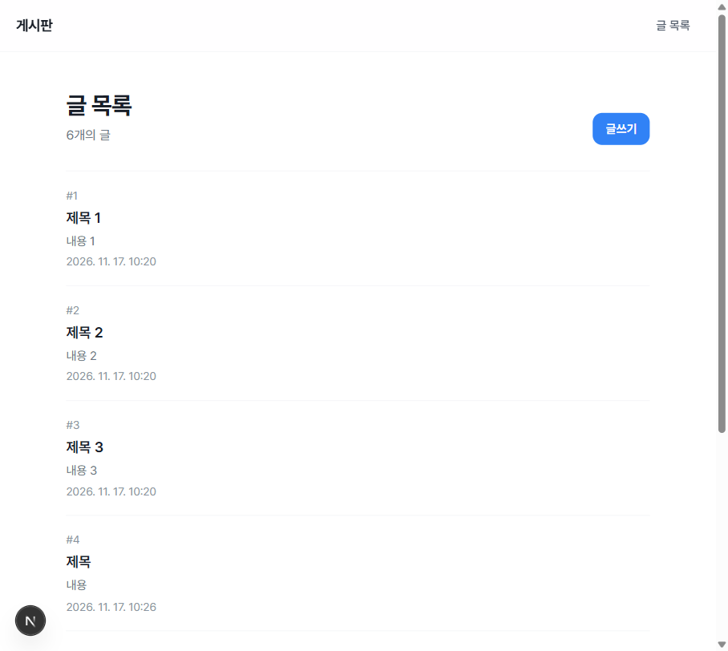
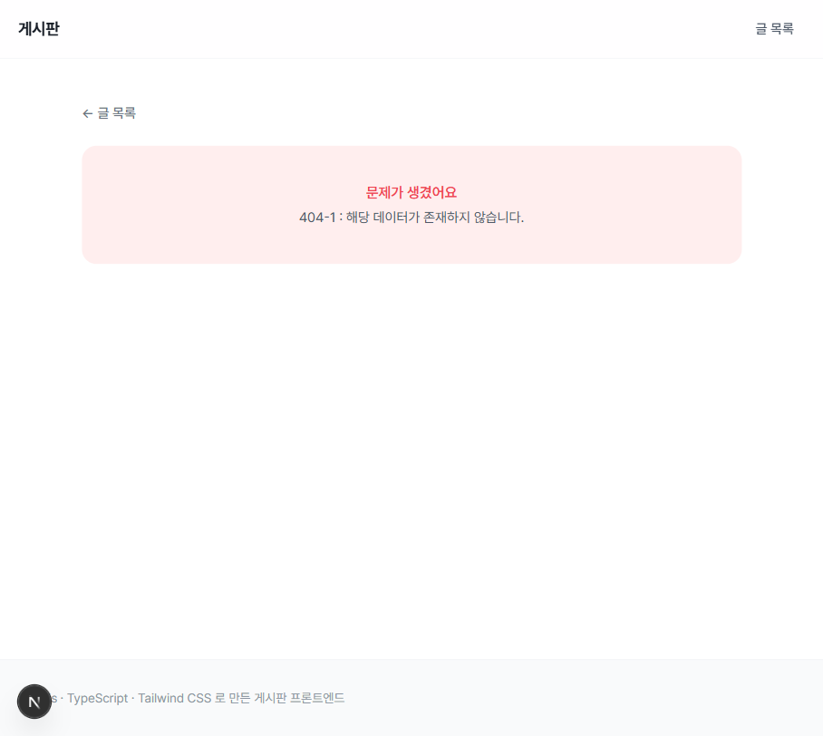
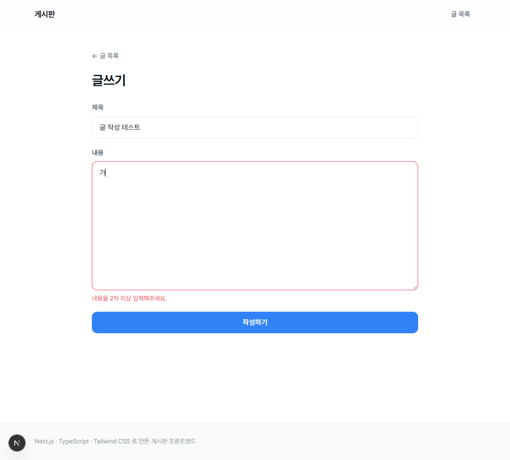
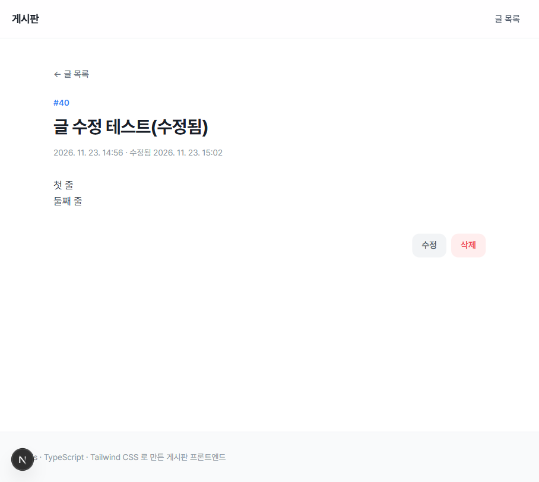

# 2부. 글 CRUD (006 ~ 010)

[← README](../README.md) · [1부](part1-setup.md) · **2부** · [3부](part3-comments.md) · [4부](part4-refactor-comment-modify.md)

## 요약

| 태그 | 커밋 | 내용 | 핵심 개념 |
|---|---|---|---|
| [`006`](https://github.com/tbafe26/p-14175-2/commit/006) | `feat` | 글 다건조회(목록) | `useEffect` 1회 fetch, 초기값 `null`, 스켈레톤 |
| [`007`](https://github.com/tbafe26/p-14175-2/commit/007) | `feat` | 글 단건조회(상세) | `useParams`, `loading.tsx` = Suspense 경계, 커스텀 훅 |
| [`008`](https://github.com/tbafe26/p-14175-2/commit/008) | `feat` | 글 삭제 | `confirm`, `router.replace`, 클로저 |
| [`009`](https://github.com/tbafe26/p-14175-2/commit/009) | `feat` | 글 작성 | 공용 폼, 칸별 유효성 검사, 백엔드와 같은 규칙 |
| [`010`](https://github.com/tbafe26/p-14175-2/commit/010) | `feat` | 글 수정 | 폼 재사용, `defaultValue` 와 렌더링 시점 |

## 단계별 상세

#### 006 글 다건조회(목록)
[이 시점의 코드](https://github.com/tbafe26/p-14175-2/tree/006) · [변경 내용](https://github.com/tbafe26/p-14175-2/commit/006)

**무엇을** `/posts` 에서 `GET /api/v1/posts` 를 호출해 번호, 제목, 본문 첫 줄, 작성일을 보여 줍니다. 불러오는 중에는 스켈레톤, 실패하면 오류 상자, 0개면 안내 문구를 보여 줍니다.

```tsx
const [posts, setPosts] = useState<PostDto[] | null>(null);

useEffect(() => {
  apiFetch<PostDto[]>("/api/v1/posts")
    .then(setPosts)
    .catch((e) => setError(toErrorMessage(e)));
}, []);
```

**왜**
- fetch 는 한 번만 실행되어야 하므로 의존성 배열이 빈 `useEffect` 안에서 부릅니다. 컴포넌트 본문에서 바로 부르면 렌더링마다 요청이 나갑니다.
- 상태 초기값을 `[]` 가 아니라 `null` 로 둡니다. `[]` 로 시작하면 "아직 불러오는 중"과 "글이 정말 없음"을 구분할 수 없습니다.
- fetch 는 비동기(Promise)라 응답을 기다리는 동안에도 화면이 그려지고 사용자는 스크롤·클릭을 할 수 있습니다. 그 사이에 스켈레톤을 보여 줍니다.
- 상태별 화면은 가드 클로즈(early return)로 하나씩 처리해 중첩을 줄였습니다.

**확인** 백엔드 실행 상태에서 `/posts` 접속 시 샘플 글이 표시됨.



#### 007 글 단건조회(상세)
[이 시점의 코드](https://github.com/tbafe26/p-14175-2/tree/007) · [변경 내용](https://github.com/tbafe26/p-14175-2/commit/007)

**무엇을**
- `src/app/posts/[id]/page.tsx`: `useParams()` 로 id 를 읽어 `Number` 로 변환
- `src/hooks/usePost.ts`: 글 하나를 불러오는 훅(`{ id, post, error }`)
- `src/app/posts/[id]/_components/PostInfo.tsx`: 번호, 제목, 작성일(수정됐으면 "수정됨"), 본문
- `src/app/posts/[id]/loading.tsx`: `[id]` 경로의 Suspense 경계

**왜**
- **Cache Components 가 켜진 프로젝트에서는** `useParams()` 처럼 요청이 들어와야 알 수 있는 값을 `<Suspense>` 밖에서 읽으면 `Blocking Route` 오류가 나고 `pnpm build` 도 실패합니다. 같은 폴더에 `loading.tsx` 를 두면 Next.js 가 그 폴더의 페이지를 자동으로 `<Suspense fallback={<Loading />}>` 으로 감쌉니다. `[id]` 폴더에 두었으므로 하위의 `edit` 페이지도 같은 경계 안에 들어갑니다.
- 데이터 로직(훅)과 화면(컴포넌트)을 처음부터 나눠, 삭제와 댓글이 붙어도 페이지 컴포넌트가 거대해지지 않게 했습니다. `_components` 처럼 `_` 로 시작하는 폴더는 라우트가 되지 않습니다.
- 하위 컴포넌트는 props 타입을 `ReturnType<typeof usePost>` 로 받습니다. 훅에 함수가 추가돼도 타입을 따로 고칠 필요가 없습니다.

**확인** `/posts/1` 은 글 표시, `/posts/9999` 는 `404-1 : 해당 데이터가 존재하지 않습니다.` 표시.



#### 008 글 삭제
[이 시점의 코드](https://github.com/tbafe26/p-14175-2/tree/008) · [변경 내용](https://github.com/tbafe26/p-14175-2/commit/008)

**무엇을** `usePost` 에 `deletePost()` 를 추가하고, 상세 하단에 삭제 버튼을 두었습니다. `confirm` → `DELETE` → 응답 `msg` alert → `router.replace("/posts")`.

**왜**
- 되돌릴 수 없는 동작이라 `confirm` 으로 한 번 더 묻습니다.
- `push` 대신 `replace` 로 이동해, 목록에서 뒤로 가기를 눌러도 이미 삭제된 글 화면으로 돌아가지 않습니다.

| 구분 | 바닐라 JS (전체 새로고침) | Next.js (부분 갱신) |
|---|---|---|
| 일반 이동 | `location.href = '주소'` | `router.push('주소')` |
| 기록 없이 이동 | `location.replace('주소')` | `router.replace('주소')` |

- 훅은 받은 `id` 를 기억(클로저)하므로 `deletePost()` 에 id 를 다시 넘기지 않습니다. 훅은 Promise 만 돌려주고, 메시지와 이동은 화면 쪽이 정합니다.
- 응답 전에 버튼을 다시 누르면 요청이 중복되므로, 요청 중에는 버튼을 비활성화합니다.

**확인** confirm 취소 시 그대로, 확인 시 alert 후 목록으로 이동하고 백엔드에서 404.

#### 009 글 작성
[이 시점의 코드](https://github.com/tbafe26/p-14175-2/tree/009) · [변경 내용](https://github.com/tbafe26/p-14175-2/commit/009)

**무엇을**
- `/posts/write` 페이지: `POST /api/v1/posts` → alert → `router.replace(/posts/새 id)`
- `src/components/post/PostForm.tsx`: 작성/수정 공용 폼(검사, 요청 중 상태, 서버 오류 표시)
- `src/lib/validation.ts`: `validateText()` 와 백엔드와 같은 길이 규칙(제목 2~100, 내용 2~5000, 댓글 2~100)

**왜**
- 백엔드도 `@NotBlank`, `@Size` 로 검사하지만 요청 전에 화면에서 먼저 걸러야 왕복 없이 바로 알려 줄 수 있습니다. 유효성 검사는 세밀할수록 좋습니다.
- alert 로 하나씩 알리는 대신 칸마다 오류를 함께 보여 주고 첫 번째 잘못된 칸에 포커스를 둡니다.
- 받침 유무로 을/를, 은/는 을 골라 "제목을 입력해주세요." 처럼 자연스러운 문장을 만듭니다.
- 작성 후 `replace` 로 이동해 뒤로 가기로 작성 폼에 돌아와 같은 글을 또 올리지 않게 합니다.

**확인** 빈 값 → 두 칸 모두 오류, 1자 → 최소 길이 오류, 정상 입력 → 상세로 이동하고 줄바꿈 유지.



#### 010 글 수정
[이 시점의 코드](https://github.com/tbafe26/p-14175-2/tree/010) · [변경 내용](https://github.com/tbafe26/p-14175-2/commit/010)

**무엇을** `/posts/[id]/edit` 페이지와 `usePost.modifyPost()` 를 추가하고, 상세에 "수정" 버튼을 두었습니다. 기존 글을 불러와 `PostForm` 의 초기값으로 넣고, `PUT` 후 상세로 이동합니다.

**왜**
- 작성과 수정은 입력 칸과 규칙이 같아 `PostForm` 을 재사용하고, 페이지는 "어떤 API 를 부르고 어디로 갈지"만 정합니다.
- `defaultValue` 는 처음 그릴 때만 반영되므로 **글을 다 불러온 뒤에만** 폼을 렌더링합니다. 먼저 그리면 빈 칸으로 고정됩니다.
- 상위 `[id]/loading.tsx` 가 이 페이지도 감싸므로 따로 `loading.tsx` 가 필요 없습니다.

**확인** 수정 페이지에 기존 값이 채워지고, 저장하면 상세에 바뀐 제목과 "수정됨 날짜" 표시.



---

[← 1부](part1-setup.md) · **2부** · [3부 →](part3-comments.md)
