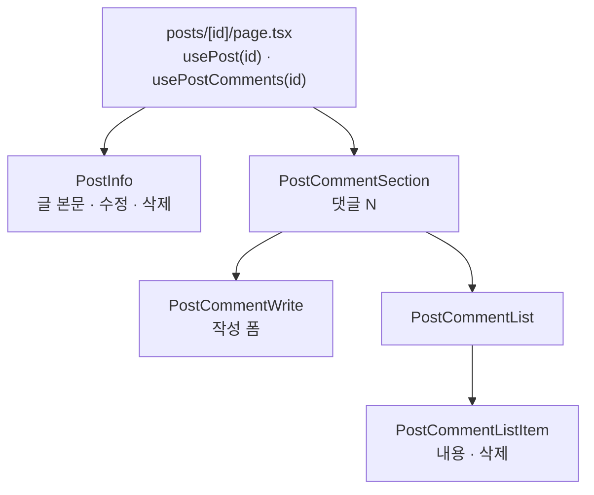
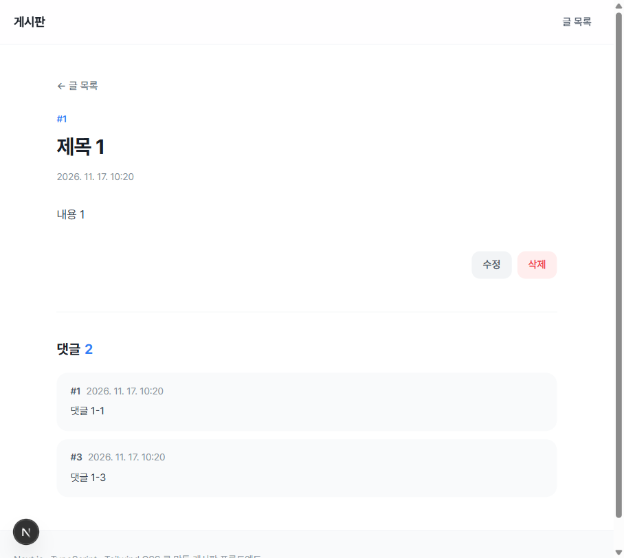
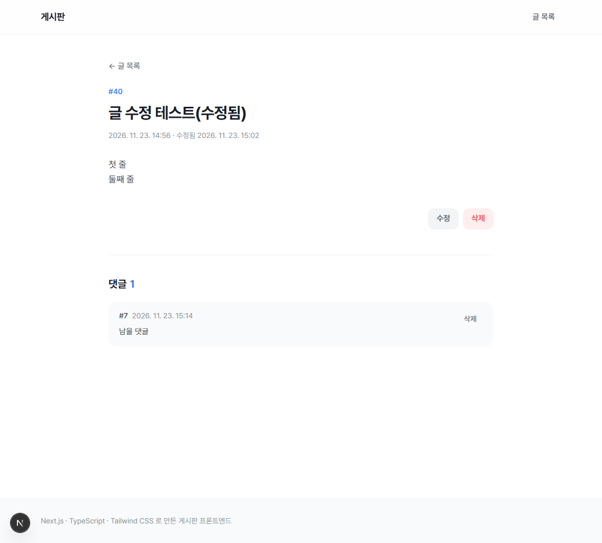
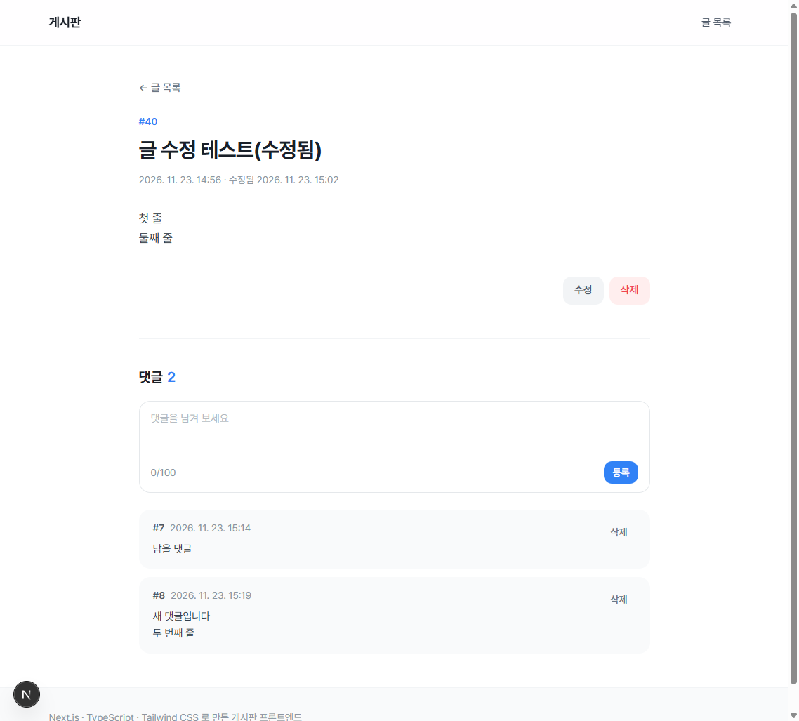

# 3부. 댓글 (011 ~ 013)

[← README](../README.md) · [1부](part1-setup.md) · [2부](part2-posts.md) · **3부**

## 요약

| 태그 | 커밋 | 내용 | 핵심 개념 |
|---|---|---|---|
| [`011`](https://github.com/tbafe26/p-14175-2/commit/011) | `feat` | 댓글 다건조회(목록) | 훅 분리, 훅 결과를 통째로 전달, `ReturnType` |
| [`012`](https://github.com/tbafe26/p-14175-2/commit/012) | `feat` | 댓글 삭제 | 성공 후 상태 갱신, 함수형 업데이트 |
| [`013`](https://github.com/tbafe26/p-14175-2/commit/013) | `feat` | 댓글 작성 | 응답 데이터로 목록에 추가, 폼 상태 지역화 |

## 컴포넌트 구조



## 단계별 상세

#### 011 댓글 다건조회(목록)
[이 시점의 코드](https://github.com/tbafe26/p-14175-2/tree/011) · [변경 내용](https://github.com/tbafe26/p-14175-2/commit/011)

**무엇을**
- `src/hooks/usePostComments.ts`: `GET /api/v1/posts/{postId}/comments`, `{ postId, postComments, error }`
- `PostCommentSection`(제목 "댓글 N"), `PostCommentList`(스켈레톤 / 오류 / 없음 / 목록), `PostCommentListItem`(번호, 날짜, 본문)
- 상세 페이지에서 두 훅을 실행하고 결과 객체를 그대로 하위에 전달

**왜**
- 글과 댓글은 서로 다른 API 이므로 훅도 나눠 로딩·오류 상태를 따로 가집니다. 댓글만 실패해도 글은 읽을 수 있습니다.
- 상위에서 훅 결과를 구조분해하지 않고 통째로 넘기면, 하위 컴포넌트가 필요한 것만 꺼내 쓰고 props 가 늘어나지 않습니다.
- 목록과 항목을 나눠 두면 삭제 같은 항목 단위 상호작용을 항목 컴포넌트 안에 가둘 수 있습니다.

**확인** 1번 글은 댓글 2개, 40번 글은 "아직 댓글이 없어요." 표시.



#### 012 댓글 삭제
[이 시점의 코드](https://github.com/tbafe26/p-14175-2/tree/012) · [변경 내용](https://github.com/tbafe26/p-14175-2/commit/012)

**무엇을** `usePostComments.deleteComment(commentId)` 와 항목별 삭제 버튼을 추가했습니다. 요청이 성공하면 상태에서도 그 댓글을 지웁니다.

```ts
setPostComments((prev) => prev?.filter((comment) => comment.id !== commentId) ?? prev);
```

**왜**
- API 로만 삭제하면 서버에서는 지워져도 화면 상태는 그대로라 새로고침해야 보입니다. 성공 후 상태도 갱신해 바로 반영합니다.
- 바깥의 `postComments` 를 기준으로 계산하면 요청을 보낸 시점의 값이 클로저에 갇혀, 응답을 기다리는 동안 생긴 변경을 덮어쓸 수 있습니다. **함수형 업데이트**는 반영 시점의 최신 값을 기준으로 합니다.
- 버튼마다 글자가 "삭제"로 같아서 `aria-label="N번 댓글 삭제"` 로 구분합니다.

**확인** confirm → alert "N번 댓글이 삭제되었습니다." → 새로고침 없이 개수와 목록 갱신, 백엔드에서도 삭제.



#### 013 댓글 작성
[이 시점의 코드](https://github.com/tbafe26/p-14175-2/tree/013) · [변경 내용](https://github.com/tbafe26/p-14175-2/commit/013)

**무엇을** `usePostComments.writeComment(content)` 와 `PostCommentWrite`(글자 수 N/100, 등록 버튼, 칸 아래 오류 문구)를 추가했습니다. 성공하면 응답의 새 댓글을 목록 끝에 붙이고 입력 칸을 비웁니다.

**왜**
- 백엔드는 응답 전에 `flush()` 해서 id 와 날짜가 채워진 새 댓글을 돌려줍니다. 그 값을 상태에 붙이면 목록을 다시 조회하지 않아도 됩니다.
- 글자 수, 오류, 요청 중 상태는 폼 컴포넌트 안에만 둬서 목록 렌더링과 섞이지 않게 합니다.
- 검사 규칙(2~100자)은 백엔드 `@Size(min = 2, max = 100)` 와 같습니다.

**확인** 1자 → 오류 문구, 두 줄 댓글 등록 → alert 후 목록 끝에 추가(줄바꿈 유지), 입력 칸 비워짐.



---

[← 2부](part2-posts.md) · **3부** · [README →](../README.md)
