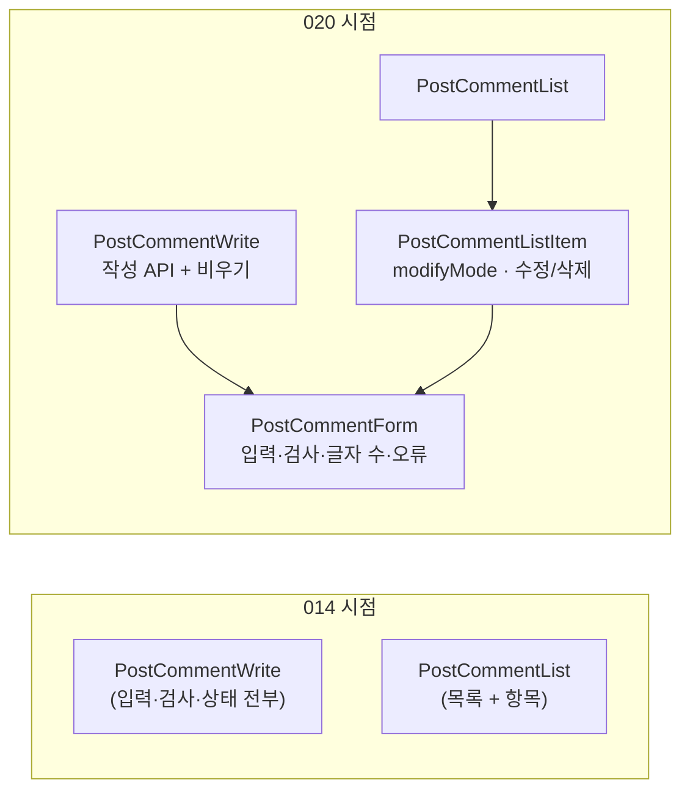
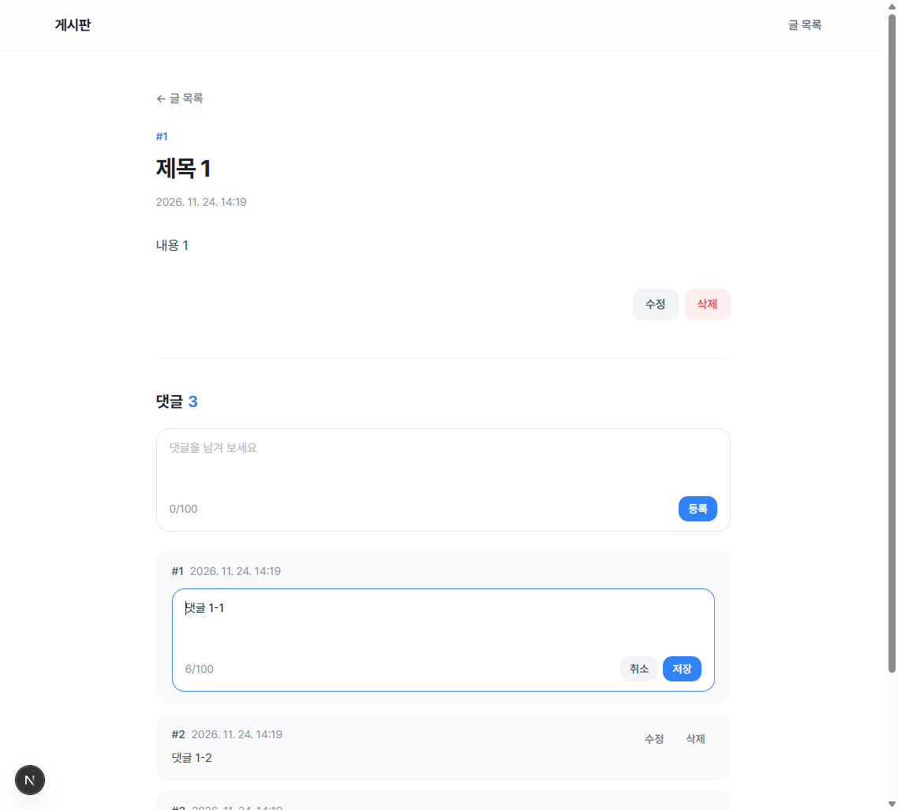
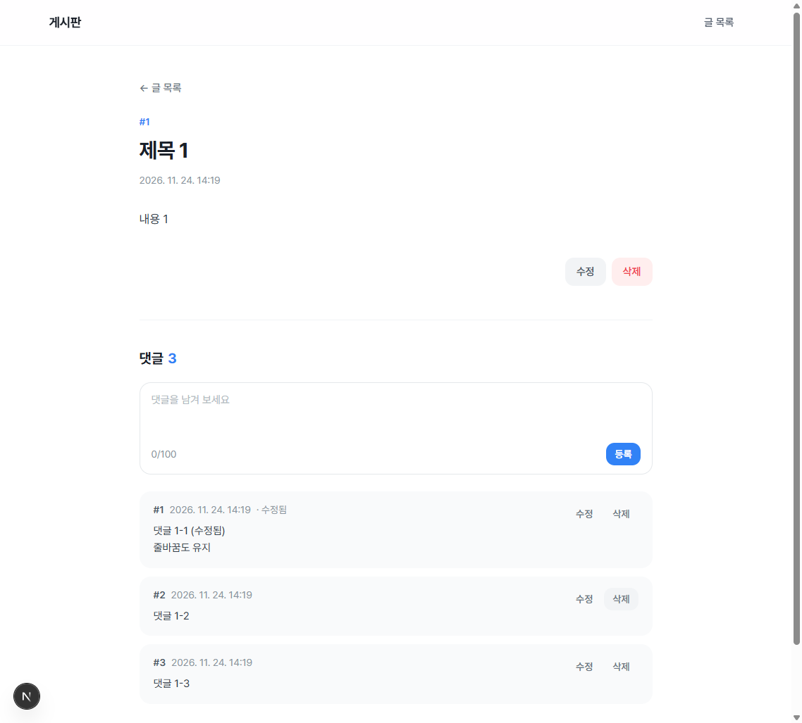

# 4부. 리팩토링과 댓글 수정 (015 ~ 020)

[← README](../README.md) · [1부](part1-setup.md) · [2부](part2-posts.md) · [3부](part3-comments.md) · **4부**

[강의](https://www.slog.gg/p/14175) 35~51강을 기준으로 진행했습니다. 35~48강의 내용(세밀한 검사, `res.ok` 로 예외 처리, 훅 분리, `ReturnType`, 클로저, `postId` 명명, 목록 항목 분리)은 1~3부에서 처음부터 그 구조로 만들었습니다. 그래서 4부의 리팩토링은 **남은 중복을 걷어 내고 댓글 수정이 들어갈 자리를 만드는 일**에 집중했습니다.

## 요약

| 태그 | 커밋 | 내용 | 강의 | 핵심 개념 |
|---|---|---|---|---|
| [`015`](https://github.com/tbafe26/p-14175-2/commit/015) | `refactor` | 페이지 공통 틀(`PageContainer`)과 뒤로 가기 링크(`BackLink`) 추출 | 37 | 반복되는 마크업을 컴포넌트로 |
| [`016`](https://github.com/tbafe26/p-14175-2/commit/016) | `refactor` | path 파라미터 → 숫자 글 번호를 `usePostIdParam` 훅으로, `id` → `postId` | 40, 47 | path 파라미터는 문자열, 의미가 드러나는 이름 |
| [`017`](https://github.com/tbafe26/p-14175-2/commit/017) | `refactor` | 댓글 입력 폼을 `PostCommentForm` 으로 분리 | 43, 44 | 작성/수정 공용 폼, 함수 재정의 |
| [`018`](https://github.com/tbafe26/p-14175-2/commit/018) | `refactor` | 댓글 항목을 `PostCommentListItem` 파일로 분리 | 48 | 항목 단위 상태를 항목 안에 |
| [`019`](https://github.com/tbafe26/p-14175-2/commit/019) | `feat` | 댓글 수정 모드 토글 | 49 | `modifyMode` 상태로 내용 ↔ 폼 전환 |
| [`020`](https://github.com/tbafe26/p-14175-2/commit/020) | `feat` | 댓글 수정 API 연동과 목록 반영 | 50, 51 | `PUT` 후 단건조회로 교체, 함수형 업데이트 |

## 리팩토링 전후 구조



## 단계별 상세

#### 015 페이지 공통 틀과 뒤로 가기 링크 추출
[이 시점의 코드](https://github.com/tbafe26/p-14175-2/tree/015) · [변경 내용](https://github.com/tbafe26/p-14175-2/commit/015)

**무엇을** `mx-auto w-full max-w-3xl px-5 py-12` 틀을 `PageContainer` 로, "← 글 목록" 같은 링크를 `BackLink` 로 만들고 글 목록·글쓰기·상세·수정 페이지에 적용했습니다.

**왜** 같은 클래스 묶음과 링크 마크업이 4개 페이지에 복사되어 있어, 폭이나 여백을 바꾸려면 4곳을 모두 고쳐야 했습니다. 페이지에는 "무엇을 보여 줄지"만 남깁니다.

**확인** 4개 페이지의 본문 텍스트가 리팩토링 전과 같음.

#### 016 usePostIdParam 훅, postId 이름
[이 시점의 코드](https://github.com/tbafe26/p-14175-2/tree/016) · [변경 내용](https://github.com/tbafe26/p-14175-2/commit/016)

**무엇을**

```ts
export function usePostIdParam() {
  const { id } = useParams<{ id: string }>();

  return Number(id);
}
```

상세 페이지에서는 `const postId = usePostIdParam();` 로 받아 `usePost(postId)`, `usePostComments(postId)` 에 넘깁니다.

**왜**
- path 파라미터는 **항상 문자열**로만 받을 수 있습니다(40강). 숫자 변환이 `[id]` 아래 페이지마다 반복되어 한 곳으로 모았습니다.
- 글 번호와 댓글 번호가 한 화면에 함께 쓰이면 `id` 보다 `postId` 가 분명합니다(47강). 댓글 수정에서 `commentId` 와 나란히 써도 헷갈리지 않습니다.
- 훅 안에서 `useParams()` 를 쓰므로 `[id]/loading.tsx` 의 Suspense 경계 안에서만 호출해야 합니다.

**확인** 상세·수정 페이지 동작 동일, Suspense 관련 오류 없음.

#### 017 댓글 입력 폼 분리
[이 시점의 코드](https://github.com/tbafe26/p-14175-2/tree/017) · [변경 내용](https://github.com/tbafe26/p-14175-2/commit/017)

**무엇을** `PostCommentWrite` 안에 있던 입력 칸, 글자 수, 2~100자 검사, 요청 중 상태, 오류 표시를 `PostCommentForm` 으로 옮겼습니다. `PostCommentWrite` 는 작성 API 호출과 "성공하면 비우기"만 넘기는 얇은 컴포넌트가 되었습니다.

```tsx
const { writeComment: _writeComment } = postCommentsState;

// 훅의 함수를 받아, 화면에서 필요한 동작(alert)을 덧붙인 같은 이름의 함수로 다시 정의한다(43강).
const writeComment = (content: string) =>
  _writeComment(content).then((rsData) => alert(rsData.msg));

return <PostCommentForm submitLabel="등록" onSubmit={writeComment} resetOnSuccess />;
```

**왜** 댓글 수정에도 같은 입력 칸과 같은 검사 규칙이 필요합니다. 강의 코드는 작성 폼과 수정 폼에 검사 코드를 따로 두지만, 규칙이 한 곳에 있어야 한쪽만 고치는 실수를 막을 수 있습니다. 수정 폼에만 필요한 취소 버튼과 Esc 취소는 `onCancel` 이 있을 때만 나타납니다.

**확인** 작성 폼의 모양과 검사, 작성 후 비우기가 그대로 동작.

#### 018 댓글 항목 파일 분리
[이 시점의 코드](https://github.com/tbafe26/p-14175-2/tree/018) · [변경 내용](https://github.com/tbafe26/p-14175-2/commit/018)

**무엇을** `PostCommentList.tsx` 안의 `PostCommentListItem` 을 별도 파일로 옮겼습니다. 목록 파일에는 상태별 분기와 반복만 남았습니다.

**왜** `li` 하나를 컴포넌트로 두면 항목마다 따로 필요한 상태(삭제 중, 수정 모드)를 그 안에 가둘 수 있습니다(48강). 수정 기능으로 항목이 커질 것을 대비해 파일을 나눴습니다.

**확인** 댓글 목록 표시 동일.

#### 019 댓글 수정 모드 토글
[이 시점의 코드](https://github.com/tbafe26/p-14175-2/tree/019) · [변경 내용](https://github.com/tbafe26/p-14175-2/commit/019)

**무엇을**

```tsx
const [modifyMode, setModifyMode] = useState(false);
const toggleModifyMode = () => setModifyMode(!modifyMode);

{!modifyMode && <p className="whitespace-pre-line">{comment.content}</p>}
{modifyMode && (
  <PostCommentForm
    defaultValue={comment.content}
    submitLabel="저장"
    onSubmit={modifyComment}
    onCancel={toggleModifyMode}
    autoFocus
  />
)}
```

- 수정 폼은 기존 내용으로 채워지고 포커스되며, 커서는 내용 맨 끝에 놓입니다.
- "취소" 버튼이나 Esc 키로 닫습니다. 수정 중에는 바깥의 수정/삭제 버튼을 숨깁니다.
- 이 커밋에서는 "저장"이 검사까지만 하고 API 는 부르지 않습니다(49-2강과 같은 단계).

**왜**
- `modifyMode` 상태 값에 따라 댓글 내용과 수정 폼이 서로 바뀌어 보입니다(49강). 상태가 항목 컴포넌트 안에 있으므로 댓글마다 따로 수정할 수 있습니다.
- 강의는 한 버튼의 글자가 "수정"/"수정취소"로 바뀌는 방식입니다. 이 저장소는 폼 안에 취소와 저장을 나란히 두고 바깥 버튼을 숨겨, 지금 누를 수 있는 동작을 분명히 했습니다.

**확인** 수정 → 기존 내용·포커스·커서 끝, 취소/Esc → 원래 내용 복귀, 1자 저장 → 검사 오류.



#### 020 댓글 수정 API 연동과 목록 반영
[이 시점의 코드](https://github.com/tbafe26/p-14175-2/tree/020) · [변경 내용](https://github.com/tbafe26/p-14175-2/commit/020)

**무엇을**

```ts
const modifyComment = async (commentId: number, content: string) => {
  const path = `/api/v1/posts/${postId}/comments/${commentId}`;

  const rsData = await apiFetch<RsData>(path, { method: "PUT", body: JSON.stringify({ content }) });

  // 수정 API 는 data 가 없으므로 단건조회로 수정 시각까지 받아 온다.
  const modified = await apiFetch<PostCommentDto>(path).catch(() => null);

  setPostComments((prev) =>
    prev?.map((comment) => comment.id === commentId ? (modified ?? { ...comment, content }) : comment) ?? prev,
  );

  return rsData;
};
```

- 성공: 응답 `msg` alert → 수정 모드 종료 → 바뀐 내용과 "· 수정됨" 표시
- 실패: 폼 아래에 `resultCode : msg`, 수정 모드와 입력한 내용 유지

**왜**
- 수정 폼 submit 시 검사 후 수정 API 를 호출하고(50-1강), 성공하면 이미 렌더링된 기존 댓글을 바꿉니다(50-2강).
- 백엔드 수정 API 는 `RsData<Void>` 라 수정 시각을 알려 주지 않습니다. 단건조회로 서버의 최신 댓글을 받아 교체하면 "수정됨" 표시까지 새로고침 없이 정확합니다. 목록 전체가 아니라 바뀐 하나만 받아 옵니다.
- 상태는 함수형 업데이트로 바꿔, 응답을 기다리는 사이 다른 댓글이 작성·삭제되어도 덮어쓰지 않습니다.
- 51강(여러 줄 본문, 버튼 위쪽 정렬)은 `whitespace-pre-line`, `items-start` 로 3부부터 반영되어 있습니다.

**확인**
- 1번 댓글을 두 줄로 수정 → alert "1번 댓글이 수정되었습니다." → 목록에 두 줄과 "· 수정됨", 백엔드도 같은 내용
- 수정 폼을 연 채 서버에서 댓글을 지우고 저장 → `404-1 : 해당 데이터가 존재하지 않습니다.`, 수정 모드 유지



---

[← 3부](part3-comments.md) · **4부** · [README →](../README.md)
